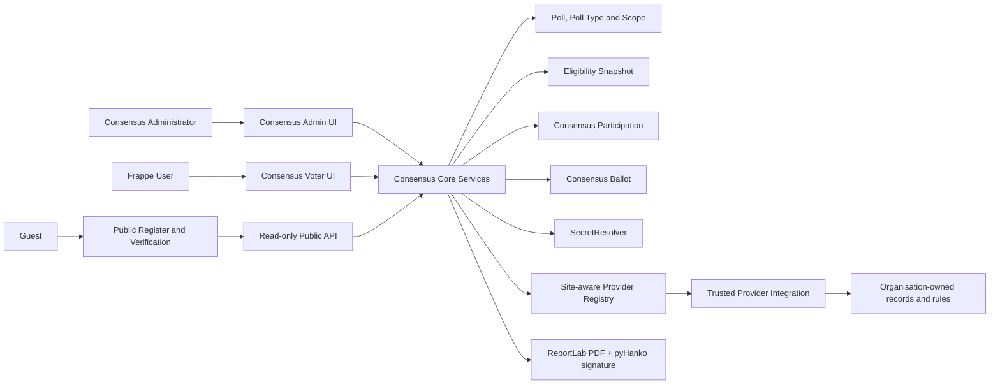
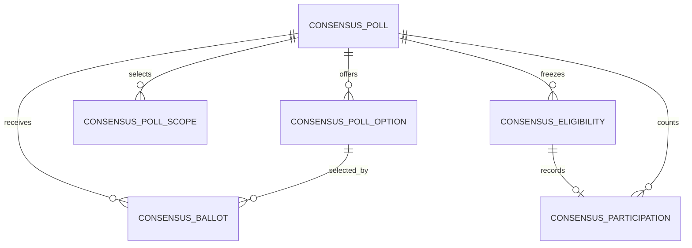

# Consensus Architecture Specification

**Status:** Consolidated design for approval. No voting-engine implementation is authorized by this document.

This document records approved architectural decisions separately from operational choices that remain to be configured. It is intended to guide implementation of the standalone Frappe app `consensus`, titled **Consensus**, whose Frappe module is **Consensus**.

## 1. Purpose and boundaries

Consensus is a reusable Frappe application for elections, resolutions, referendums, and polls in apartment associations, clubs, cooperative societies, employee organisations, and other membership-based organisations.

Consensus core owns:

- Poll configuration, Poll Types, scope selection and lifecycle.
- Provider registry and versioned provider contract.
- Eligibility snapshots and voter authorization.
- OTP, participation, anonymous ballot casting, idempotency and recovery.
- Signed PDF receipts, anonymous ballot registers and public verification.
- Generic administrator, authenticated voter, and guest read-only interfaces.

Consensus core depends on Frappe and must remain independent of ERPNext. It must not contain organisation-specific DocTypes, SQL, membership policy, accounting rules, or assumptions about flats, blocks, floors, owners, tenants, committees, or associations.

Organisation-specific scope, voter discovery, eligibility, weight, contact, and identity data are supplied by trusted provider integrations. The Society ERP provider will be a separate adapter in `society_erp`, implemented only after the Consensus core is ready. The existing `society_erp` voting module remains untouched until Consensus is fully implemented and tested. No legacy voting-record migration is required.

## 2. Component architecture



Logical service boundaries:

- `providers`: versioned contract, hook discovery, validation, scope resolution.
- `security`: AES-GCM encryption, voter and idempotency HMACs, OTP authorization, secret resolution.
- `eligibility`: deterministic paginated snapshots and immutability checks.
- `voting`: transactional cast and recovery.
- `receipts`: signed PDF generation from frozen identity and display snapshots.
- `register`: canonical ballot verification, publication hash, public projection and downloads.
- `api`: permission-separated administrator, authenticated voter, and guest endpoints.

## 3. Poll Type and Voting Scope

Poll Type and Voting Scope are independent.

- **Poll Type** describes a poll’s category or purpose: examples include General Election, Committee Election, Resolution, Referendum, Opinion Poll, or organisation-defined types. Poll Types are configurable records, not a hardcoded enum.
- **Voting Scope** selects the population. A trusted provider defines available scope types and entities, hierarchy, inclusion/exclusion semantics, voter discovery, and eligibility rules.

A Committee Election may target a block, department, committee, or another supported group. A Resolution may target the whole organisation or selected groups. Consensus does not infer meaning from either label.

A poll may include multiple scope selections and provider-defined conditions. Each selection records its provider scope type, opaque entity reference, include/exclude mode, parent reference where relevant, and provider-resolved label/hierarchy snapshot. The provider validates the query, supported operators, hierarchy, inclusion/exclusion precedence, and combined conditions.

### Poll Type defaults and poll-specific configuration

The selected Poll Type may provide a default provider rule key and configuration. A poll may override configuration for that same rule using the provider-validated JSON Merge Patch semantics:

- Objects merge recursively.
- Arrays replace; they do not concatenate.
- `false`, `0`, and empty arrays are preserved as explicit values.
- `null` is accepted only where the provider schema permits it.
- Unknown keys or invalid values are rejected by the provider.
- If the poll chooses a different rule key, its configuration is complete for that rule; defaults for another rule are not merged.

The provider returns a canonical validated effective configuration and rule version. Those values, the Poll Type configuration version/hash, and the scope expression are frozen before opening.

The current flat Any/All fields can express only a limited combination shape. If nested expressions are needed, the provider contract must validate a structured expression tree. Consensus stores and hashes the canonical provider-validated expression; it does not interpret organisation-specific conditions.

## 4. Trusted provider architecture

Providers are trusted server-side integrations registered through Frappe hooks (for example, `consensus_voter_providers`). The site administrator selects a registered provider key in settings. Do not accept arbitrary Python paths, SQL, or untrusted provider selection from user input. Public endpoints do not accept a provider key; they resolve the provider from the active site configuration and the provider version pinned to the poll.

### Versioned provider contract (design)

A provider exposes a stable key and exact supported API version and implements operations equivalent to:

```text
get_metadata() -> ProviderMetadata
list_scope_types(context) -> ScopeType[]
list_scope_entities(scope_type, query, parent_ref, context) -> ScopeEntity[]
resolve_scope_entities(scope_type, entity_refs, context) -> ScopeEntity[]
validate_scope_query(query, poll_context) -> CanonicalScopeQuery
validate_rule_configuration(rule_key, config, poll_type, poll_context)
    -> CanonicalRuleConfig(rule_key, rule_version, config)
begin_voter_snapshot(poll_context) -> ProviderSnapshotToken
get_voter_candidates(query, poll_context, snapshot_token, cursor, page_size)
    -> CandidatePage(candidates, next_cursor, snapshot_token)
evaluate_eligibility(candidate, poll_context, effective_rule_config)
    -> EligibilityDecision
get_receipt_identity(voter_ref, purpose, schema_version)
    -> ReceiptIdentity(schema_key, schema_version, fields)
get_contact_destination(voter_ref, channel) -> ContactDestination
```

V1 authentication is Frappe User authentication only. Candidate data uses `frappe_user: str | None` and maps to a Frappe User record; there is no undefined generic `auth_subject` in v1. External authentication can be designed later as a separate versioned capability.

Provider requirements:

- Voter references are stable, opaque, non-semantic identifiers, not names, email addresses, or unit labels.
- Provider scope type declarations state hierarchy, multiple-selection support, supported operators, and condition capabilities.
- Scope resolution must return every requested entity exactly once and no unrequested entities. Consensus rejects missing, unexpected, or duplicate results.
- Candidate pages use a stable cursor/order and provider snapshot token so pages reflect one consistent source-data snapshot.
- A voter candidate carries only the stable opaque voter reference, optional Frappe User, and the minimum fields needed to decide eligibility. Receipt identity/contact information comes from separate purpose-specific methods.
- Eligibility decisions return a valid decimal-compatible weight and rule version.
- Receipt identity schema declares field keys, labels, display order, formatting, and required/optional status.

### Site-aware registry

Do not use a process-global `@lru_cache(maxsize=1)` for provider discovery: a worker may serve multiple Frappe sites. Safest default is to resolve hook registrations in the current site context. If caching is needed, key it by `frappe.local.site` and the site’s installed-app/hook generation, and clear on app install/migrate or hook changes. Provider instances must not retain mutable site-specific settings between calls.

### Society ERP provider

The future adapter belongs to `society_erp` and will map its own data to generic provider structures. It may use flat/block/floor, Owner/Tenant, committee membership, UDS, association-specific identity, and dues. None of these concepts or queries belongs in Consensus. The provider is developed after the core is ready and tested alongside the existing Society ERP voting implementation; it does not replace or modify that implementation during development.

## 5. Eligibility snapshot and identity protection

Before a poll opens, Consensus must create a complete snapshot and mark it immutable. Freeze:

- Poll Type key/record and configuration version/hash.
- Provider key and API version.
- Provider rule key, rule version, and canonical effective configuration.
- Canonical scope selections, include/exclude values, operators, conditions, resolved labels, parents, and hierarchy paths.
- Every eligible stable voter reference and its keyed digest.
- Frappe User allocation, where present.
- Eligibility result, category/context required for administration, and exact voting weight.
- Receipt identity schema key/version and resolved required identity/context values.
- Voter-reference HMAC, idempotency HMAC, encryption, and signing key versions relevant to the poll.
- Snapshot completion status, count, deterministic hash, and completion time.

### Receipt identity schema

The provider defines each receipt field’s key, display label, order, formatting, and required/optional status. At snapshot creation, the provider supplies resolved display values. Consensus validates required fields and stores the minimal identity/context snapshot in protected Consensus Eligibility storage. This is identity-side data—not an assembled receipt payload.

Identity values are encrypted at rest. They are accessible only to narrowly authorized eligibility and receipt services and are excluded from ordinary reports/exports, public APIs, QR claims, and the public register. They are never copied to Consensus Ballot. Incomplete required identity data blocks snapshot completion/opening. Receipt generation fails closed if the stored snapshot is missing, corrupt, undecryptable, or incomplete; it does not silently omit fields or retrieve changed provider data.

### Large electorates and deterministic snapshots

Use provider snapshot tokens and stable cursor pagination. Process pages in a deterministic order, reject duplicate voter references across pages, validate weights and required fields, and build a canonical snapshot representation in that order. Stream its canonical bytes into a hash to avoid holding a large electorate in memory.

The voter-reference digest is a keyed HMAC-SHA-256 over domain-separated canonical input containing the site identifier, provider key, poll reference, and stable provider voter reference. The canonical structure is versioned (for example, `consensus:voter-ref:v1`) and unambiguously serialized; it is not assembled by ambiguous string concatenation. The HMAC key version is pinned for the poll. Including the poll reference makes the digest stable for the same voter within that poll while producing a different digest for that voter in another poll; including site and provider also prevents cross-site/provider correlation. Eligibility and Participation use the same stored digest for that poll.

A partially built snapshot remains unusable and cannot be opened. Completion requires consistent token/version, counts, unique references, final hash, and all batches successfully persisted. On failure, resume only against the same valid provider snapshot token or discard the incomplete build and start a new snapshot. Opening is permitted only after the frozen rows and metadata are complete and immutable.

The deterministic snapshot hash is computed from a canonical manifest and voter rows in stable order (ordered by the poll-scoped voter-reference digest). It includes frozen Poll Type/provider/rule/scope metadata, each voter digest, canonical decimal voting weight, eligibility result, and an identity-snapshot commitment. AES-GCM ciphertext and nonce bytes are explicitly excluded: encryption uses random nonces, so identical identity values must not be expected to produce identical ciphertext. For each identity snapshot, decrypt only in the protected snapshot service, canonicalize the provider-defined schema/version and resolved display fields, then compute a purpose-separated HMAC commitment using the snapshot-integrity key version pinned to the poll. Include that commitment and its key version in the manifest/row. Verification decrypts the stored snapshot, recomputes and constant-time compares its commitment, then recomputes the deterministic manifest hash. Re-encrypting unchanged identity values with a new AES-GCM nonce therefore leaves the logical snapshot hash unchanged; changing identity content, schema, or formatting changes the commitment. The integrity HMAC key version must be retained for the snapshot verification period.

## 6. DocType relationships and privacy boundary



Eligibility and Participation are identity-side. Ballot is anonymous. There is **no** Link, shared transaction ID, or copied voter digest between Participation/Eligibility and Ballot. Ballot shares only the poll, selected option, and required anonymous vote details. The idempotency digest is the explicitly accepted exception as pseudonymous metadata; it is HMAC-protected, voter-bound, restricted, and never exposed publicly.

### Consensus Eligibility

Contains poll, voter-reference HMAC digest and key version, AES-GCM-encrypted provider reference with nonce and encryption-key version, optional Frappe User allocation, frozen identity/context snapshot ciphertext and schema/key versions, restricted voter category/context, voting weight, eligibility status/reason, provider/API/rule/scope snapshot identifiers, and snapshot time/hash reference.

The voter reference and display snapshot are sensitive identity-side data. They are not returned from generic APIs or reports. Database unique constraint: `(poll, voter_ref_digest)`.

### Consensus Participation

Contains poll, Eligibility Link, voter-reference digest, Frappe User allocation, participation time, and authorization method. It contains no selected option, receipt code, ballot hash, Ballot Link, or idempotency digest. Database unique constraint: `(poll, voter_ref_digest)`.

### Consensus Ballot

Contains poll, high-entropy receipt code, selected Consensus Poll Option Link, voting weight, original cast time, ballot hash, HMAC idempotency digest and key version, and hash format version. It contains no voter, User, Eligibility, Participation, provider reference, voter digest, identity/context, or shared correlation identifier.

Database unique constraints: `(poll, receipt_code)` and `(poll, idempotency_hmac_key_version, idempotency_digest)`.

### Consensus Poll Option

A regular DocType containing poll Link, label, description, display order, enabled status, and opaque option key. Database unique constraint: `(poll, option_key)`. Option labels and internal option references are frozen when the poll opens. Internal option row names never appear in QR claims or public register output.

### Consensus Poll and Scope

Consensus Poll links to a configurable Poll Type and stores dates/status/settings, provider identity/version, selected scope child rows, operators/conditions, rule config, snapshot build/completion metadata, key versions, and published register metadata/hash. The Poll Type, title, option labels, scope and eligibility configuration are immutable after opening.

Consensus Poll Scope child rows store provider scope type/entity reference, include/exclude, parent reference, resolved display label and hierarchy snapshot, and provider version. Reject duplicate `(scope_type, entity_ref)` selections regardless of inclusion mode. Enforce with validation and, if supported for child rows, an idempotently created database unique index scoped by parent/poll.

## 7. Vote casting, idempotency, and recovery

The client generates a cryptographically random idempotency key and retains it for retries. Consensus stores only an HMAC digest using a domain-separated canonical encoding of:

```text
poll reference
voter_ref_digest
raw client idempotency key
```

The HMAC key version is pinned to the poll and stored on Ballot with the digest. The raw key is never stored or logged. The digest is pseudonymous metadata: it can permit correlation if the HMAC key is compromised or misused. Restrict access to both digest and key; do not describe this design as forensically unlinkable.

Recovery authenticates the Frappe User, independently resolves and verifies the poll’s frozen Eligibility row and matching Participation, computes the digest using that voter and the poll-pinned key version, and retrieves only the matching Ballot. If a user has more than one eligible allocation, the request must identify an Eligibility record that the server revalidates as belonging to that session. A key alone never authorizes receipt recovery.

### Atomic cast sequence

Within one database transaction:

1. Authenticate Frappe User.
2. Resolve exactly one eligible frozen allocation and verify the User mapping.
3. Lock the Poll row or use equivalent concurrency protection.
4. Validate poll state/time, option membership/enabled status, OTP authorization, and idempotency request.
5. Check for a safe retry; otherwise proceed with a new cast.
6. Insert Participation, guarded by unique `(poll, voter_ref_digest)`.
7. Insert anonymous Ballot, guarded by unique receipt and idempotency constraints.
8. Mark Eligibility as Voted.
9. Commit once. Any exception rolls back all vote changes; no manual commit between operations.

V1 disables vote changes. Revoting, if ever needed, requires a separate anonymous protocol and is not implemented through ballot states or links.

## 8. Receipt generation and public verification

Reuse the current Society ERP approach: ReportLab creates the PDF and pyHanko applies a visible cryptographic PDF signature. The signing private key remains outside the database and Git, resolved through the configurable SecretResolver. A missing key or signing failure returns an error; no unsigned PDF is presented as signed.

After the vote transaction commits, a separate authenticated receipt-generation/download request assembles the PDF from:

- Frozen Eligibility identity/context snapshot and provider receipt schema.
- Frozen poll title/reference and option label/internal option reference.
- Stored Ballot receipt code, cast time, weight, and ballot hash.

No receipt payload or assembled PDF contents are persisted. Regeneration cannot cast another vote and does not retrieve mutable identity data from the provider. It can be retried after successful casting. Signing-key rotation policy is described in Section 10.

The signed PDF contains voter name and appropriate provider-supplied identification/context, poll title/reference, selected option label, receipt code, voting weight, original cast time, and ballot hash. This identifying information is present in the voter-held PDF and protected Eligibility snapshot only; it is never copied into Ballot, QR claims, or the public register.

QR claims remain the existing anonymous fields: poll reference, receipt code, ballot hash, base64url-encoded option label, and weight formatted to three decimal places. The public ballot register exposes only receipt code, option label, weight, and ballot hash (plus public poll/register metadata). It never exposes identity/context or internal option IDs.

Guest APIs are read-only. They return explicit projections, never serialized DocTypes. The register is published only after closing; publication hashes verified anonymous ballot rows. Guest reads recompute and compare the register hash and fail closed on mismatch. Receipt verification compares QR claims to the public register and stored anonymous ballot, recalculating the ballot hash.

PDF signature verification detects modification after signing and validates the signer certificate according to the verifier’s trust configuration. Register verification establishes that receipt claims match a published ballot entry. Neither proves that the voter’s intent was correctly recorded.

## 9. Hash compatibility baseline

Retain the existing Society ERP algorithms without silent canonicalization changes.

### Ballot hash

Current `_ballot_hash()` hashes SHA-256 over compact UTF-8 JSON with sorted keys and `ensure_ascii=False`. Payload fields are:

- `poll`
- `receipt_code`
- `selected_option` (internal option row name)
- `option_label`
- `voting_weight` formatted as `f"{float(weight):.3f}"`
- `cast_on` represented by `str(cast_time)`

Serialization uses `separators=(",", ":")`. Consensus uses the Consensus Poll Option internal row name in this canonical field, while ensuring it never appears in public QR/register data.

### Register hash

Current `_register_hash()` hashes compact JSON with sorted object keys, Unicode preserved, and compact separators. Its canonical ordered rows contain receipt code, internal selected-option value, selected-option label, float voting weight, and ballot hash. The current rows are ordered by receipt code ascending. `_public_ballot_projection()` omits the internal selected-option value.

Keep the register’s canonical row shape/order and public-projection separation. Do not change QR claim names/encoding, option-label base64url encoding, weight formatting, timestamp representation, sorting, or JSON canonicalization without an explicitly versioned format and compatibility review.

### Golden test requirements

Before release, add fixed-input golden tests with expected ballot and register digests, including Unicode option labels, decimal rounding, timestamp representation, row ordering, and empty/single/multiple ballot registers. Add assertions that internal option IDs, identity fields, provider references, and voter digests do not appear in guest JSON, CSV/PDF text, QR claims, or verification results.

## 10. SecretResolver, encryption, and key lifecycle

Consensus defines a configurable `SecretResolver` interface. It does not hardcode a secret manager, environment format, filesystem layout, or vendor. A trusted resolver is registered/configured and resolves a secret or cryptographic handle by reference, purpose, and version; it can report an active version. Purposes include:

- PDF signing private key.
- AES-256-GCM encryption keys for provider voter references and identity snapshots.
- HMAC keys for voter-reference digests.
- HMAC keys for idempotency digests.
- Purpose-separated HMAC keys for identity-snapshot commitments used by deterministic snapshot verification.

Only references and version identifiers are stored in DocTypes. Secret material remains outside the application database and Git. HMAC and encryption keys are separate, and HMAC purposes use distinct key material or an explicitly domain-separated derivation. Poll snapshots pin voter-reference, identity-snapshot commitment, encryption, and signing key versions; idempotency HMAC versions are pinned to the poll. Old versions are retained for the required recovery/regeneration/verification period. Missing/unavailable keys fail closed; no plaintext or unsigned fallback is allowed.

### AES-GCM boundary

Use application-level AES-256-GCM. Store ciphertext, nonce, and key version. Bind ciphertext with associated data covering site, poll, provider, and voter digest so encrypted values cannot be moved between records undetected. Decrypt only in restricted provider/eligibility/receipt services. Never log or expose decrypted values. Rotation either retains old keys for reads or decrypts/re-encrypts under controlled rotation while preserving the frozen semantic value.

### HMAC key handling

Voter-reference HMAC is keyed, not a plain SHA-256 of predictable identifiers. Its domain-separated canonical input includes site, provider, poll reference, and stable voter reference, so the digest is consistent within a poll and differs across polls. Pin the voter digest key version for a poll snapshot. Pin the identity-snapshot commitment HMAC key version for deterministic verification, and pin the idempotency key version for the poll; retain each while its dependent snapshot/ballots remain supported. Include key-version columns/metadata in relevant records and database uniqueness constraints.

### Signing-key compromise policy

- Stop using a compromised key for new signatures.
- Preserve original signed receipts and verification capability wherever technically and legally appropriate.
- Mark the affected signing certificate/key version compromised.
- Never silently regenerate an old receipt under a replacement key and represent it as the original signature.
- If re-signing is necessary, clearly identify the replacement signature and preserve original receipt details and signature history.
- Consider trusted timestamping for stronger evidence of signature creation time.

## 11. Database integrity, permissions, and anonymity threat model

### Required unique constraints and indexes

Database-level unique constraints:

- Eligibility: `(poll, voter_ref_digest)`.
- Participation: `(poll, voter_ref_digest)`.
- Ballot: `(poll, receipt_code)`.
- Ballot idempotency: `(poll, idempotency_hmac_key_version, idempotency_digest)`.
- Poll Option: `(poll, option_key)`.
- Poll Scope: unique `(parent, parenttype, parentfield, scope_type, entity_ref)` within its parent poll.

Additional lookup indexes include Eligibility `(poll, auth_user, eligibility_status)`, Participation `(poll, auth_user)`, Ballot `(poll, receipt_code)`, and Poll `(status, ends_at)`. Constraint installation must be idempotent and supported on MariaDB and PostgreSQL. Fresh installation creates the indexes; no legacy Society ERP data migration is required.

### Roles and access

- **Consensus Administrator:** Poll/Poll Type/scope configuration, lifecycle actions, and provider settings; no raw Ballot read.
- **Eligibility Officer:** narrowly scoped Eligibility access; no unrestricted export/report permission.
- **Voter:** own poll/eligibility/participation operations through authenticated APIs, not generic table access.
- **Restricted internal services:** create/read Eligibility and Participation; cast, verify, and aggregate Ballot through explicit functions.
- **Guest:** read-only published anonymous register, downloads, and receipt verification.

Ballot has no ordinary Desk list/read/report/export permission. Disable unnecessary Ballot tracking, comments, imports, and generic document endpoints. Poll administrators receive aggregate results and audit summaries only through authorized functions. Site/database administrators can ultimately inspect stored data; application permissions cannot protect against them.

### Anonymity limitation

No direct database link or shared correlation ID connects identity records to Ballot. Public APIs contain no identity or context. However, Frappe `owner`, `creation`, `modified`, row order, transaction timing, request logs, and privileged access can potentially correlate records, particularly in small polls. The application-level design reduces direct correlation; it does not claim forensic unlinkability against privileged database operators. The idempotency digest is also pseudonymous metadata and must be restricted.

## 12. Fresh installation and deployment

Consensus is installed as a standalone Frappe app with its own module, DocTypes, roles, permissions, hooks, dependencies, and unique-index setup. Frappe is the platform dependency; Consensus core does not require ERPNext. PDF generation/signing and AES-GCM packaging dependencies must be declared when implemented.

Fresh install creates app-owned DocTypes/roles. Idempotent migration hooks create or verify database uniqueness indexes. There is no migration of existing Society ERP voting records. The optional Society ERP provider and resident portal integration are later work. The existing Society ERP voting module remains untouched during Consensus development and testing. Production deployment requires separate approval.

## 13. Implementation phases

### Phase 1 – Core foundation

- App structure.
- Settings and roles.
- Provider registry and protocol.
- SecretResolver interface.
- Encryption and HMAC services.
- Core Poll, Poll Type, and Scope schemas.

### Phase 2 – Eligibility

- Provider scope discovery and validation.
- Rule validation.
- Paginated eligibility snapshot generation.
- Identity snapshot encryption.
- Snapshot hashing and immutability.

### Phase 3 – Voting engine

- Poll Option.
- Eligibility and Participation.
- Anonymous Ballot.
- OTP and authorization.
- Atomic vote casting.
- Idempotency and recovery.

Vote changes/revoting are disabled in v1.

### Phase 4 – Receipts and public verification

- ReportLab PDF generation.
- pyHanko digital signing.
- QR claims.
- Receipt retry and recovery.
- Anonymous ballot register.
- Guest verification.

### Phase 5 – Society ERP integration

- Separate Society ERP provider.
- Association-specific eligibility and scope rules.
- Resident portal integration.
- Testing alongside the existing voting module.

### Phase 6 – Validation

- Security and permission tests.
- Concurrency and rollback tests.
- Hash golden tests.
- PDF signature and tampering tests.
- QR and public-register privacy tests.
- End-to-end election tests.

Do not retire or modify the existing Society ERP voting implementation until Consensus has passed all required tests and a separate transition decision is approved.

## 14. Unresolved operational decisions

These are deployment/configuration decisions, not reasons to redesign the approved architecture:

1. Exact identity/context fields and formatting for each provider’s receipt schema.
2. Retention periods for identity snapshots, encryption/HMAC keys, and historical signing keys.
3. Choice of secret manager or environment-specific `SecretResolver` implementation.
4. Operational handling and any legal implications of compromised signing certificates.
5. Whether trusted timestamping will be used.

## 15. Remaining technical risks to validate during implementation

- Frappe standard metadata and transaction timing can permit privileged forensic correlation despite the lack of a relational identity-to-ballot link.
- Large electorate snapshot consistency depends on the provider honoring its snapshot token and stable cursor contract.
- Unique index DDL and transaction/locking behavior must be validated on supported MariaDB and PostgreSQL versions.
- Poll Type/Poll rule merge behavior must be implemented exactly as documented and covered by provider validation tests.
- Long-term receipt regeneration depends on retained encrypted identity snapshots and historical secret/signing key versions.
- A PDF signature proves document integrity from signing time, while the register verifies ballot inclusion; neither proves that a vote reflected the voter’s intent.

## 16. Expected implementation file areas

The eventual implementation is expected to add/update files only in the Consensus app for core schemas, controllers, providers, services, APIs, UI, hooks, packaging, and tests. Later, the Society ERP integration will add a distinct provider module and hook registration in `society_erp`; its existing voting DocTypes, APIs, PDF code, hooks, and pages remain untouched until Consensus is ready for integrated testing. This architecture-document task does not authorize any of those implementation changes.
